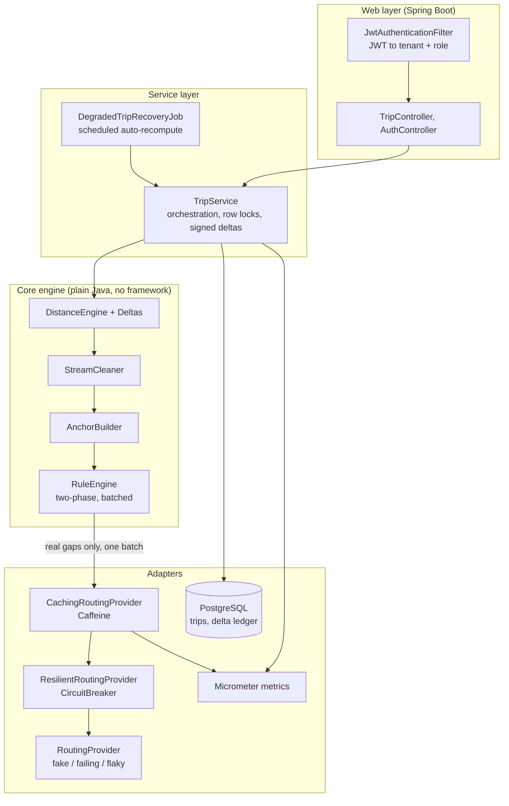
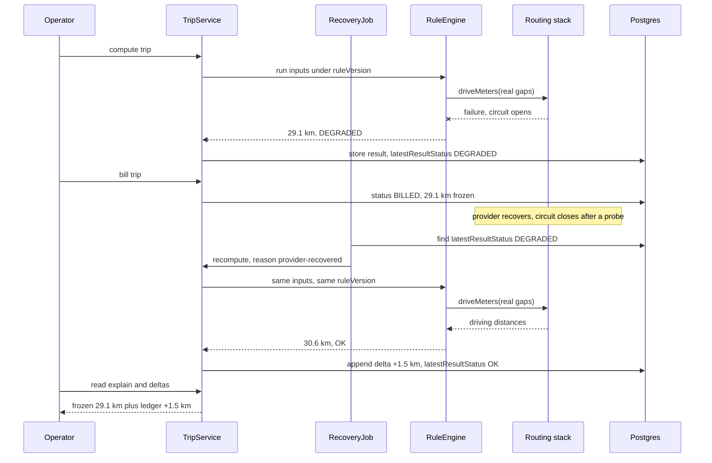

# Design Note — GPS Gap Backfill & Billable Distance Reconstruction

**MoveInSync Backend Case Study 2026 · Case Study 1 · Advanced Track**

> Rebuild a **trusted, explainable** billable distance for every trip from unreliable GPS, so
> MoveInSync and the cab vendor can agree on every kilometre — and so a dispute can be
> answered line by line.

---

## 1. Problem in one paragraph

Vendors are paid **per kilometre**, so distance is money. The raw signal (GPS pings) is noisy:
duplicates, out-of-order fixes, low-accuracy fixes, "teleport" jumps, and long gaps (tunnels,
basements, dead phones). A naive sum of ping-to-ping distance **under-pays**; calling a routing
API for every gap **over-pays** on noise and **costs a fortune**. We rebuild distance with a
**deterministic, versioned rule engine** that uses cheap maths where it can, trusted anchor points
where it must, and a (rate-limited, paid, failure-prone) routing provider only for *real* gaps —
labelling every segment with the rule that produced it.

### Non-negotiable guarantees
1. **Determinism** — same input + same `ruleVersion` ⇒ *exactly* the same kilometres. Two runs that disagree by 0.1 km are a billing bug.
2. **Explainability** — every output segment carries the rule that produced it (`SHORT_GAP_AERIAL`, `PARKED`, `ROUTED`, `REJECTED_SPEED`, `DEGRADED_AERIAL`).
3. **Idempotent recompute** — late pings never silently rewrite a closed invoice; they produce a **signed delta** (`+1.8 km`) on an append-only ledger.
4. **Cost control** — routing calls are cached and batched; we report calls-per-trip *before and after* caching.
5. **Tenant isolation** — one client can never read another client's trips; no PII in logs or errors.

---

## 2. Scope & assumptions

**In scope:** ingest/clean pings, anchor construction with fallback ordering, per-segment distance
rules, routing provider with cache + circuit breaker, idempotent recompute + signed deltas,
auth/tenant isolation, metrics, the 10k-trip benchmark, and the failure-injection test.

**Deliberately out (stated as trade-offs, §12):** map-matching to actual road geometry (we
approximate), real-time streaming ingestion (batch recompute per trip is enough for billing),
multi-region replication, a product UI (the map page is a demo aid).

**Assumptions:**
- The routing provider is an **interface** we own. Only a deterministic fake is wired in (haversine
  × 1.3); no real maps API is called, so no key is needed to run or grade this. Failing and flaky
  fakes drive the failure tests.
- Coordinates are WGS84 lat/lon. Distances use the **haversine** formula on a spherical Earth
  (error documented in §10).
- "Billing closed" is a trip state; after it, results are immutable and only deltas are appended.

---

## 3. Data model

```
Trip  (table trips; (tenantId, tripId) is unique)
 ├── id                        # generated key
 ├── tripId, tenantId
 ├── status                    # OPEN, COMPUTED, BILLED
 ├── totalMeters, providerCalls, resultStatus {OK, DEGRADED}, ruleVersion, inputHash, computedAt
 │                             # the current result; frozen once BILLED
 ├── segmentsJson              # the labelled segments behind that result
 ├── inputsJson                # latest pings, milestones, riders, office; still updated after BILLED
 └── latestResultStatus        # how the newest compute went; drives auto-recovery

DistanceDelta (table distance_deltas, append-only by code: nothing updates or deletes a row)
 └── tripId, tenantId, fromRef, toRef, deltaMeters (signed), reason, createdAt

Ping       { location, timestamp, accuracyMeters }
Milestone  { kind {TRIP_START, PICKUP, DROP, NO_SHOW}, riderId?, location?, time? }
Rider      { riderId, kind {AD_HOC, PLANNED}, home?, signInTime?, plannedLocation?, plannedTime? }
Segment    { from, to, meters, rule, providerCall }
```

`resultStatus` and `latestResultStatus` differ only on a billed trip: the first belongs to the frozen
invoice, the second records whether the newest evidence was computed cleanly.

Persistence is **PostgreSQL**, with the schema created by Hibernate. The routing cache is in-process
**Caffeine** (§6).

---

## 4. Architecture

Clean controller → service → **framework-free core** → repository/adapter layering. The core
algorithm has **no Spring, no DB, no HTTP**, so every rule is unit-testable in isolation.



**Key design choices**
- `RuleEngine` tries the cheap classifiers in a *fixed* order, then routes every remaining gap in one
  batch. Determinism comes from that fixed order plus the rule version, not from call timing.
- `RoutingProvider` is an **interface** with single and batch calls. The cache and breaker wrap any
  implementation as decorators, so a real HTTP provider can be added without touching the engine.
- A write takes the trip's **row lock** first, so concurrent writes to one trip run in turn (§7).

---

## 5. The core algorithm (deterministic pipeline)

### Stage 1 — Clean the stream
1. **Sort** by timestamp (handles out-of-order delivery).
2. **Drop low-accuracy** fixes (`accuracyMeters` above the threshold, default 50 m).
3. **Dedupe** exact repeats (same coordinates, time and accuracy).
4. **Drop teleports** — any fix whose implied speed from the previous kept fix exceeds
   `maxSpeedKmh` (default 120). *Example: a 9 km jump in 4 s ⇒ 8,000 km/h ⇒ dropped.*

### Stage 2 — Build anchors (patch the gaps)
Merge cleaned pings with **anchor points** on one timeline, ordered by time:
- **Employee anchor** — actual pickup/drop if valid; else fallback **in order**:
  `AD_HOC rider home + sign-in time` → `PLANNED location + planned time`.
- **No-show anchor** (behind a config flag) — no-show location, or planned location if invalid.
- **Office anchor** — actual trip-end **only if within 400 m** of planned office; otherwise planned
  office location with the trip-end time.

### Stage 3 — Distance per segment (cheap cases first)
For each consecutive pair `(A, B)` on the timeline:

| Condition | Rule | Distance |
|---|---|---|
| gap < 70 s at plausible speed, or no time gap | `SHORT_GAP_AERIAL` | haversine(A,B) |
| long gap but speed < 5 km/h (parked) | `PARKED` | haversine(A,B) |
| otherwise | `ROUTED` | provider drive distance |
| routed > 100 km, **or** (implied speed > limit **and** haversine×1.4 implies a speed > limit) | `REJECTED_SPEED` | haversine(A,B); the routed figure is discarded |
| provider circuit open | `DEGRADED_AERIAL` | haversine×1.4, trip → `DEGRADED` |

The brief says to reject such a route but not what to bill instead. We use plain haversine: a
provider answer that failed the sanity check should not raise the bill, so the segment pays the
known lower bound and stays visible by its label.

### Stage 4 — Aggregate
Sum in **integer metres**, convert to km **once** at the end, round **half-up to 3 decimals**
(documented rounding — §10). Attach the rule label and `providerCall` flag to every segment;
emit `providerCalls` count.

---

## 6. Caching & provider-cost control

- **Key:** both endpoints rounded to 3 decimal places (cells of roughly 110 m), so nearby gap
  endpoints share one entry.
- **Batch:** a trip's real gaps go to the provider in one call; only cache misses are sent.
- **Report:** `providerCalls` per trip, and calls before and after caching in the benchmark.
- **Eviction & staleness:** Caffeine, LRU-style at 100,000 entries, with a 7-day write TTL. *What can
  go stale:* a cached drive distance if a road changes. *For how long:* at most 7 days. *How bounded:*
  the TTL limits age and the size cap limits memory. Failed calls are never cached.
- **Determinism caveat:** the same inputs give the same kilometres only while the provider's answers
  are stable. The fake provider always is; a real one could change after the cache entry expires,
  which would show up as a signed delta on recompute.

---

## 7. Resilience & idempotency (the heart of "trust")

- **Circuit breaker** (hand-written `CircuitBreaker`): 5 consecutive failures open it, calls then
  fast-fail for 10 s, and one half-open probe closes it or re-opens it.
- **Degraded fallback:** if the batched routing call fails, every real gap in that trip becomes
  `DEGRADED_AERIAL` (haversine×1.4) and the trip is marked `DEGRADED`.
- **Auto-recompute on recovery:** every 30 s, unless the circuit is open, a job recomputes every trip
  whose latest compute was degraded. An un-billed trip is updated. A billed trip keeps its invoice and
  gets a signed delta, reason `provider-recovered`. `latestResultStatus` then reads OK, so each trip
  is corrected once.
- **Idempotent recompute:** a recompute always re-runs the engine. It is idempotent because the engine
  is deterministic and the effect is measured, not assumed: a billed trip's delta is the new total
  minus the billed total **and every delta already in the ledger**. Replaying the same evidence owes
  nothing, so nothing is appended.
- **Late evidence accumulates:** a billed trip's total and segments are frozen, but its inputs are
  not, so each late ping builds on the ones before it. Repeated pings are dropped on arrival.
- **Concurrent writes:** every write loads the trip with a pessimistic row lock. Two first-time
  computes of one trip cannot both succeed: the unique `(tenant, trip)` key rejects one with a 409.

### Failure-mode table

The ways inputs or dependencies can misbehave, what the caller observes, and how the system recovers.
Process crashes are covered by the database transaction: a write either commits whole or not at all.

| What fails | Detected by | What the user sees | How the system recovers |
|---|---|---|---|
| **Duplicate pings** (same coord+time) | `StreamCleaner` dedupe | Correct distance; duplicates silently dropped | Deterministic clean step — no action needed |
| **Out-of-order pings** | `StreamCleaner` sort by timestamp | Correct distance regardless of arrival order | Sorted before anchoring |
| **Low-accuracy fix** (`accuracyM` > threshold) | `StreamCleaner` accuracy filter | Noisy fix excluded from the total | Dropped before distance; threshold is configurable |
| **Teleport jump** (implied speed > 120 km/h) | `StreamCleaner` teleport filter | Implausible spike excluded | Fix dropped; distance measured from the last good fix |
| **Missing pickup/drop** | `AnchorBuilder` fallback chain | Distance still computed from best anchor | Falls back: home + sign-in → planned location + time |
| **Trip-end far from office** (> 400 m) | `AnchorBuilder` office rule | Billed to planned office, not the stray fix | Planned office location substituted with trip-end time |
| **Implausible routed segment** (> 100 km or too fast) | `RuleEngine` sanity check | Segment shown as `REJECTED_SPEED`, billed at straight-line distance | The routed figure is discarded |
| **Routing provider timeout / 5xx** | `CircuitBreaker` (consecutive failures) | Trip billed on a bounded estimate, status `DEGRADED` | `DEGRADED_AERIAL` fallback; trip flagged for recompute |
| **Provider keeps failing** | Circuit **opens** after threshold | Fast failure, no hanging requests; still billable | Half-open probe after cooldown tests recovery |
| **Provider recovers** | Circuit closes; scheduled job | Un-billed: corrected total, status `OK`. Billed: invoice unchanged, correction as a **signed delta** | `DegradedTripRecoveryJob` recomputes each trip once |
| **Late pings after billing** | `TripService` (trip is `BILLED`) | Billed total unchanged; correction in the ledger | Pings are kept and a signed `DistanceDelta` covers what is still owed |
| **Repeated compute or re-sent ping** | Ledger check in `Deltas.sinceLedger` | Same kilometres; no double charge | Nothing is owed, so no delta is appended |
| **Concurrent writes to one trip** | Row lock; unique `(tenant, trip)` key | Writes run in turn; a clashing first compute gets `409` | Caller retries the `409` |
| **Malformed request** | Validation and `GlobalExceptionHandler` | `400` with a short message | Nothing stored; caller fixes the request |
| **Cross-tenant access attempt** | Tenant scoping from the JWT | `404` on read; a write creates that tenant's own separate trip | Queries are tenant-scoped and ids are unique per tenant |
| **Missing / invalid token** | `JwtAuthenticationFilter` | `401 Unauthorized` | Stateless; caller re-authenticates at `/api/auth/login` |

---

## 8. Hardest flow — sequence diagram

*Provider is down during first compute → trip billed as DEGRADED → provider recovers → auto-recompute → signed delta.* This single flow exercises the circuit breaker, the fallback, the recovery job and the delta ledger. The kilometres are illustrative.



---

## 9. APIs (REST)

| Method | Path | Role | Purpose |
|---|---|---|---|
| `POST` | `/api/auth/login` | public | Exchange credentials for a JWT |
| `POST` | `/api/trips` | operator/admin | Compute a trip |
| `GET`  | `/api/trips/{id}/distance` | any | Total km, status, providerCalls |
| `GET`  | `/api/trips/{id}/explain` | any | Per-segment rule breakdown (dispute view) |
| `POST` | `/api/trips/{id}/pings` | operator/admin | Add late or out-of-order pings, then recompute |
| `POST` | `/api/trips/{id}/recompute` | operator/admin | Recompute from stored inputs |
| `POST` | `/api/trips/{id}/bill` | operator/admin | Close the invoice |
| `GET`  | `/api/trips/{id}/deltas` | any | Signed-delta ledger |

**Auth:** the JWT carries tenant and role. Every repository query is scoped by tenant. Employees can
read any trip in their tenant; per-employee scoping is left out. Errors are non-leaking, and **no home
location, phone, or email appears in logs or error bodies.** `/actuator/prometheus` needs a token.

---

## 10. Correctness notes (where graders probe)

- **Rounding & units:** accumulate in **integer metres**; divide by 1000 once; round **half-up,
  3 dp**. State it, test it. (Prevents floating-point drift that breaks determinism.)
- **Projection error:** haversine on a sphere; error vs WGS84 ellipsoid is < 0.5 % at city scale —
  acceptable and documented. Straight-line is a *lower* bound on road distance, which is why real
  gaps route and the degraded fallback multiplies by 1.4.
- **Determinism:** rule order is fixed and `ruleVersion`-tagged. Tests compute the same inputs twice,
  and across many threads, and assert identical results.

---

## 11. Complexity, monitoring, tests & benchmark

**Complexity (per trip, `n` = pings):** sort `O(n log n)`; clean/anchor/segment `O(n)`; provider
calls bounded by the number of *real* gaps `g` (usually `g ≪ n`), reduced further by the cache.
Space `O(n)`.

**Metrics:** `distance.trips.computed`, `distance.trips.degraded`, `distance.segments.rejected`,
`distance.recompute.deltas`, `distance.compute.latency` (p50, p99), `distance.provider.calls`,
`distance.provider.cache.hits`, `distance.provider.cache.size`. Logs are parameterised SLF4J lines
with `key=value` fields and no personal data.

**Tests:**
- **Unit:** each rule and anchor fallback, teleport drop, the 400 m office rule, rounding.
- **Determinism:** same inputs computed twice and across threads give identical results.
- **Concurrency:** many threads send late pings to one billed trip through the real service and
  database; the ledger still adds up. Removing the row lock makes this test fail.
- **Failure injection:** `FlakyRoutingProvider` fails partway through 10 trips; exactly the affected
  trips go `DEGRADED`. Separate tests cover the breaker and recovery of billed trips.
- **Real database:** a Testcontainers test runs on PostgreSQL in CI.
- **Benchmark:** 10,000 synthetic trips × 1,500 pings; results and limits are in the README.

---

## 12. Trade-offs (and what's left out)

| Decision | Chosen | Alternative | Why |
|---|---|---|---|
| Gap distance | haversine → route only real gaps | route everything | cost: provider calls are the dominant expense |
| Provider down | degrade (aerial×1.4) + mark + auto-recompute | block/fail the trip | availability for billing; correctness restored via deltas |
| Closed invoice changed | append signed delta | mutate the number | auditability; never rewrite a closed invoice |
| Consistency vs availability | stay available when the provider is down: bill an estimate, correct it later | block billing until the provider returns | a late correction costs less than stopped billing; the estimate is labelled and bounded |
| Consistency vs latency | row lock per trip, held through routing | optimistic retries | a billing total must not lose a concurrent update; the cost is slower writes to one trip |
| Rejected route | plain haversine | haversine × 1.4 | a route that failed the sanity check should not raise the bill |
| Map accuracy | haversine + provider for gaps | full map-matching | map-matching is large scope for marginal billing gain |

**Left out on purpose:** a real routing provider, real-time streaming ingestion, full road-network map-matching, multi-region HA, per-employee trip scoping, and a real identity provider.

---

## 13. Tech stack & run

Java 21 · Spring Boot 3.3 · PostgreSQL · Caffeine (in-process cache) · a hand-rolled circuit
breaker · JWT (jjwt) auth · Micrometer + Prometheus · JUnit 5 (+ H2 for the web/persistence tests).

**One command:** `docker compose up --build` brings up the app and Postgres (the app is built
inside Docker, so only Docker is required). The engine also runs headless for the benchmark
(`./run-benchmark.sh`).

### As-built notes
- **Caffeine instead of Redis** for the routing cache: one fewer container for a single-node
  submission. It sits behind the `RoutingProvider` interface, so a shared cache is a drop-in later.
- **Hand-rolled `CircuitBreaker`** instead of Resilience4j: small, deterministic, unit-tested.
- Providers are layered **cache → breaker → base**, so the breaker never counts a cache hit and the
  cache treats a breaker fast-fail as a miss.

### Measured (10,000 trips × 1,500 pings; Apple Silicon laptop, JDK 27)
- 2.57 s total (~3,900 trips/s); compute p50 0.23 ms, p99 0.50 ms; ~67 MB heap.
- Routing calls: **105,000 before caching → 16 after**, in **6 batched round-trips**. This is a best
  case, because the synthetic trips reuse 16 hub locations. It measures the engine alone, with no
  database or network. See the README for the limits.
