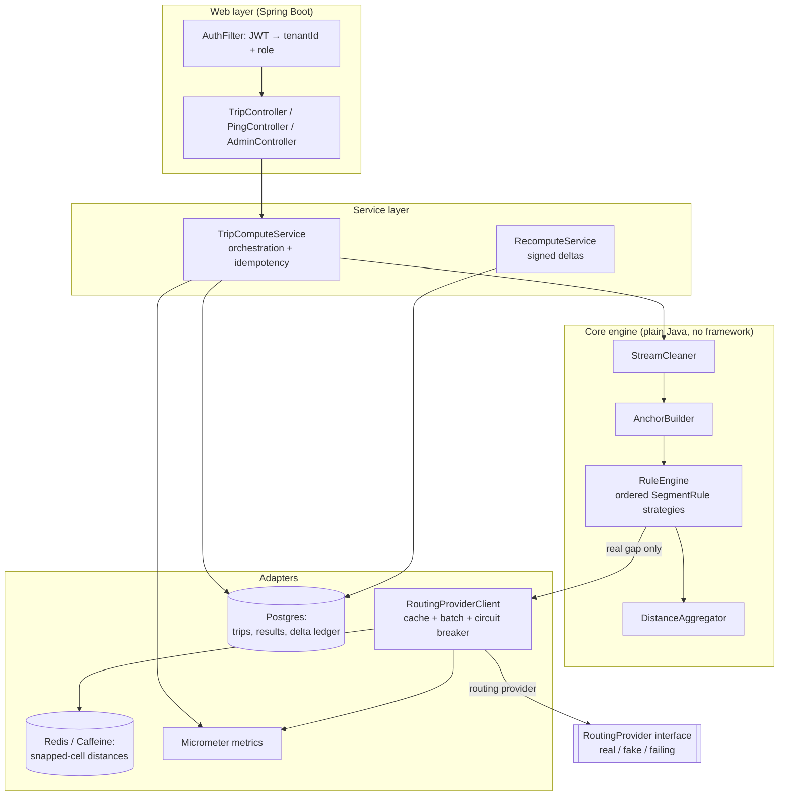

# Design Note — GPS Gap Backfill & Billable Distance Reconstruction

**MoveInSync Backend Case Study 2026 · Case Study 1 · Advanced Track**

> Rebuild a **trusted, explainable** billable distance for every trip from unreliable GPS, so
> MoveInSync and the cab vendor can agree on every kilometre — and so a dispute can be
> answered line by line.

---

## 1. Problem in one paragraph

Vendors are paid **per kilometre**, so distance is money. The raw signal (GPS pings) is noisy:
duplicates, out-of-order fixes, low-accuracy fixes, "teleport" jumps, and long gaps (tunnels,
basements, dead phones). A naive sum of ping-to-ping distance **under-pays**; calling a routing
API for every gap **over-pays** on noise and **costs a fortune**. We rebuild distance with a
**deterministic, versioned rule engine** that uses cheap maths where it can, trusted anchor points
where it must, and a (rate-limited, paid, failure-prone) routing provider only for *real* gaps —
labelling every segment with the rule that produced it.

### Non-negotiable guarantees
1. **Determinism** — same input + same `ruleVersion` ⇒ *exactly* the same kilometres. Two runs that disagree by 0.1 km are a billing bug.
2. **Explainability** — every output segment carries the rule that produced it (`SHORT_GAP_AERIAL`, `PARKED`, `ROUTED`, `REJECTED_SPEED`, `DEGRADED_AERIAL`).
3. **Idempotent recompute** — late pings never silently rewrite a closed invoice; they produce a **signed delta** (`+1.8 km`) on an append-only ledger.
4. **Cost control** — routing calls are cached and batched; we report calls-per-trip *before and after* caching.
5. **Tenant isolation** — one client can never read another client's trips; no PII in logs or errors.

---

## 2. Scope & assumptions

**In scope:** ingest/clean pings, anchor construction with fallback ordering, per-segment distance
rules, routing provider with cache + circuit breaker, idempotent recompute + signed deltas,
auth/tenant isolation, metrics, the 10k-trip benchmark, and the failure-injection test.

**Deliberately out (stated as trade-offs, §12):** map-matching to actual road geometry (we
approximate), real-time streaming ingestion (batch recompute per trip is enough for billing),
multi-region replication, a UI.

**Assumptions:**
- The routing provider is an **interface** we own; a deterministic fake drives tests and the
  "provider fails halfway" scenario. No external API key is required to run or grade this.
- Coordinates are WGS84 lat/lon. Distances use the **haversine** formula on a spherical Earth
  (error documented in §10).
- "Billing closed" is a trip state; after it, results are immutable and only deltas are appended.

---

## 3. Data model

```
Tenant (clientId)
 └── Trip
      ├── id, tenantId, type {LOGIN, LOGOUT}
      ├── plannedStops: [PlannedStop]      # planned location + planned time per rider
      ├── officeLocation (planned)
      ├── status {OPEN, COMPUTED, BILLED, DEGRADED}
      ├── ruleVersion                       # which rule set produced the current result
      ├── inputHash                         # hash of cleaned inputs → idempotency key
      ├── pings: [Ping]                     # raw, as received
      ├── milestones: [Milestone]
      └── result: DistanceResult (nullable)

Ping            { lat, lon, timestampUtc, accuracyM }           # raw device fix
Milestone       { kind {TRIP_START, PICKUP, DROP, NO_SHOW}, riderId?, lat?, lon?, timeUtc? }
Rider           { riderId, kind {AD_HOC, PLANNED}, homeLat?, homeLon?, signInTimeUtc?,
                  plannedLat?, plannedLon?, plannedTimeUtc? }

Anchor          { source {ACTUAL_PICKUP, ACTUAL_DROP, PROFILE_HOME, PLANNED, NO_SHOW,
                  ACTUAL_OFFICE, PLANNED_OFFICE}, lat, lon, timeUtc }

Segment         { fromPoint, toPoint, meters, rule {SHORT_GAP_AERIAL, PARKED, ROUTED,
                  REJECTED_SPEED, DEGRADED_AERIAL}, providerCall: boolean }

DistanceResult  { tripId, totalKm, segments: [Segment], providerCalls,
                  status {OK, DEGRADED}, ruleVersion, inputHash, computedAtUtc }

DistanceDelta   { tripId, fromVersionOrHash, toVersionOrHash, deltaKm (signed),
                  reason, createdAtUtc }    # append-only ledger; never mutate a BILLED result
```

Persistence: **PostgreSQL** for trips / results / the delta ledger (the ledger is append-only,
enforced at the DB layer). Routing-distance cache in **Redis** (or in-process Caffeine for the
single-node run) keyed by snapped cells (§6).

---

## 4. Architecture

Clean controller → service → **framework-free core** → repository/clients layering. The core
algorithm has **no Spring, no DB, no HTTP** so every rule is unit-testable in isolation.



**Key design choices**
- `RuleEngine` is a **chain of `SegmentRule` strategies** evaluated in a *fixed, versioned order*.
  Determinism is a property of (strategy order + rule version), not of call timing.
- `RoutingProvider` is an **interface** (`driveDistance(from, to) -> meters`). Implementations:
  `FakeRoutingProvider` (deterministic), `FailingRoutingProvider` (fault injection),
  and a real HTTP one. The circuit breaker and cache wrap *any* implementation.
- Idempotency lives in the service: a compute is keyed by `(tripId, inputHash, ruleVersion)`.

---

## 5. The core algorithm (deterministic pipeline)

### Stage 1 — Clean the stream
1. **Dedupe** pings (same device + same timestamp, or identical coord+time).
2. **Sort** by timestamp (handles out-of-order delivery).
3. **Drop low-accuracy** fixes (`accuracyM > accuracyThreshold`).
4. **Drop teleports** — any fix whose implied speed from the previous kept fix exceeds
   `maxSpeedKmh` (default 120). *Example: a 9 km jump in 4 s ⇒ 8,000 km/h ⇒ dropped.*

### Stage 2 — Build anchors (patch the gaps)
Merge cleaned pings with **anchor points** on one timeline, ordered by time:
- **Employee anchor** — actual pickup/drop if valid; else fallback **in order**:
  `AD_HOC rider home + sign-in time` → `PLANNED location + planned time`.
- **No-show anchor** (behind a config flag) — no-show location, or planned location if invalid.
- **Office anchor** — actual trip-end **only if within 400 m** of planned office; otherwise planned
  office location with the trip-end time.

### Stage 3 — Distance per segment (cheap cases first)
For each consecutive pair `(A, B)` on the timeline:

| Condition | Rule | Distance |
|---|---|---|
| gap < 70 s at plausible speed | `SHORT_GAP_AERIAL` | haversine(A,B) |
| long gap but speed < 5 km/h (parked) | `PARKED` | haversine(A,B) |
| otherwise | `ROUTED` | provider drive distance |
| routed > 100 km, **or** (implied speed > limit **and** haversine×1.4 > limit) | `REJECTED_SPEED` | fall back to bounded haversine×1.4 |
| provider circuit open | `DEGRADED_AERIAL` | haversine×1.4, trip → `DEGRADED` |

### Stage 4 — Aggregate
Sum in **integer metres**, convert to km **once** at the end, round **half-up to 3 decimals**
(documented rounding — §10). Attach the rule label and `providerCall` flag to every segment;
emit `providerCalls` count.

---

## 6. Caching & provider-cost control

- **Key:** `(snap(startLat,startLon), snap(endLat,endLon))` where `snap` = geohash/grid cell at a
  fixed precision (≈ a few hundred metres). Nearby gap endpoints collapse to the same key.
- **Batch:** real gaps in a trip are collected and sent to the provider in one batched call.
- **Report:** `providerCallsBeforeCache` vs `providerCallsAfterCache` per trip and in aggregate —
  this *is* the headline benchmark number.
- **Eviction & staleness:** LRU + TTL (default 7 days). *What can go stale:* a cached drive
  distance if a road genuinely changes. *Bound:* road geometry is stable on billing timescales, so
  a 7-day TTL bounds error; cache can be flushed on demand. Cache is never consulted for the
  *final* number of a disputed trip without the version it was computed under.

---

## 7. Resilience & idempotency (the heart of "trust")

- **Circuit breaker** (Resilience4j) around the provider: on repeated failures/timeouts the circuit
  **opens**, segments fall back to `DEGRADED_AERIAL` (haversine×1.4), and the trip is marked
  `DEGRADED`. A half-open probe tests recovery.
- **Auto-recompute on recovery:** when the circuit closes, a background job re-runs all `DEGRADED`
  trips and (if the number changes) emits a signed delta.
- **Idempotent recompute:** compute is keyed by `(tripId, inputHash, ruleVersion)`. Re-running with
  identical inputs is a no-op that returns the stored result.
- **Signed deltas on closed invoices:** if a `BILLED` trip recomputes to a different distance (late
  pings, provider recovery, rule-version bump), we **never mutate** the closed result — we append a
  `DistanceDelta` (`+1.8 km`, with a reason) to the ledger. Billing reconciles from deltas.

---

## 8. Hardest flow — sequence diagram

*Provider is down during first compute → trip billed as DEGRADED → provider recovers → auto-recompute → signed delta.* This single flow exercises caching, the circuit breaker, idempotency, and the delta ledger.

```mermaid
sequenceDiagram
    participant Op as Operator
    participant SVC as TripComputeService
    participant RE as RuleEngine
    participant RP as RoutingProviderClient
    participant EXT as RoutingProvider
    participant DB as Postgres (results + deltas)

    Op->>SVC: compute(tripId)
    SVC->>RE: run(cleaned inputs, ruleVersion)
    RE->>RP: driveDistance(gap)  %% real gap
    RP->>EXT: batched request
    EXT--xRP: timeout / 5xx
    RP-->>RE: circuit OPEN → fallback signal
    RE-->>SVC: result = 29.1 km, status=DEGRADED
    SVC->>DB: persist DEGRADED result (ruleVersion, inputHash)
    Note over Op,DB: trip later moves to BILLED at 29.1 km

    Note over EXT: provider recovers; circuit half-open→CLOSED
    RP->>SVC: onRecover → enqueue DEGRADED trips
    SVC->>RE: recompute(tripId, same inputs, same ruleVersion)
    RE->>RP: driveDistance(gap)
    RP->>EXT: request (now succeeds, cache miss→store)
    EXT-->>RP: 30.6 km for gap
    RE-->>SVC: result = 30.6 km, status=OK
    SVC->>DB: append DistanceDelta(+1.5 km, reason=PROVIDER_RECOVERED)
    SVC-->>Op: explain: segment-by-segment + delta ledger
```

---

## 9. APIs (REST)

| Method | Path | Role | Purpose |
|---|---|---|---|
| `POST` | `/trips/{id}/compute` | operator/admin | Compute (idempotent) |
| `GET`  | `/trips/{id}/distance` | employee(own)/operator | Total km + status + providerCalls |
| `GET`  | `/trips/{id}/explain` | operator/admin | Per-segment rule breakdown (dispute view) |
| `POST` | `/trips/{id}/pings` | ingest/operator | Add late/out-of-order pings → triggers recompute |
| `GET`  | `/trips/{id}/deltas` | operator/admin | Signed-delta ledger |
| `POST` | `/admin/provider/recover` | admin | Force circuit probe / replay DEGRADED |
| `GET`  | `/admin/metrics` | admin | Prometheus metrics |

**Auth:** JWT carries `tenantId` + `role`. Every repository query is scoped by `tenantId`
(employees additionally scoped to their own trips). Errors are non-leaking; **no home location,
phone, or email in logs or error bodies.**

---

## 10. Correctness notes (where graders probe)

- **Rounding & units:** accumulate in **integer metres**; divide by 1000 once; round **half-up,
  3 dp**. State it, test it. (Prevents floating-point drift that breaks determinism.)
- **Projection error:** haversine on a sphere; error vs WGS84 ellipsoid is < 0.5 % at city scale —
  acceptable and documented. Straight-line is a *lower* bound on road distance, which is why real
  gaps route and the degraded fallback multiplies by 1.4.
- **Determinism:** rule order is fixed and `ruleVersion`-tagged; a golden-file test asserts byte-
  identical results across runs.

---

## 11. Complexity, monitoring, test & benchmark plan

**Complexity (per trip, `n` = pings):** sort `O(n log n)`; clean/anchor/segment `O(n)`; provider
calls = number of *real* gaps `g` (usually `g ≪ n`), reduced further by cache. Space `O(n)`.

**Metrics (the 3 AM counters):** `compute_latency{p50,p99}`, `provider_calls_total`,
`provider_cache_hit_ratio`, `trips_degraded`, `rejections_total{rule}`, `recompute_deltas_total`,
`circuit_state`, `ingest_out_of_order_total`.

**Tests:**
- **Unit** — one test per rule and per anchor-fallback branch; teleport drop; office 400 m boundary; DST-free timestamp handling.
- **Determinism** — golden-file: same input run twice ⇒ identical km.
- **Concurrency** — N threads computing/recomputing the same trip ⇒ idempotent, no duplicate deltas.
- **Failure injection** — `FailingRoutingProvider` fails halfway through a batch of 10k trips ⇒ those trips go `DEGRADED`, then recover and reconcile via deltas.
- **Benchmark** — **10,000 synthetic trips × ~1,500 pings**; report run time, memory, and
  `providerCalls` **before vs after** caching, with p50/p99 compute latency and the machine spec in the README.

---

## 12. Trade-offs (and what's left out)

| Decision | Chosen | Alternative | Why |
|---|---|---|---|
| Gap distance | haversine → route only real gaps | route everything | cost: provider calls are the dominant expense |
| Provider down | degrade (aerial×1.4) + mark + auto-recompute | block/fail the trip | availability for billing; correctness restored via deltas |
| Closed invoice changed | append signed delta | mutate the number | auditability; never rewrite a closed invoice |
| Consistency model | deterministic + eventually-correct (at-least-once recompute, idempotent effect) | strong real-time | billing values must be reproducible, not instantaneous |
| Map accuracy | haversine + provider for gaps | full map-matching | map-matching is large scope for marginal billing gain |

**Left out on purpose:** real-time streaming ingestion, full road-network map-matching, multi-region HA, UI — each noted as future work with the reason.

---

## 13. Tech stack & run

Java 21 · Spring Boot 3.3 · PostgreSQL · Caffeine (in-process cache) · a hand-rolled circuit
breaker · JWT (jjwt) auth · Micrometer + Prometheus · JUnit 5 (+ H2 for the web/persistence tests).

**One command:** `docker compose up --build` brings up the app and Postgres (the app is built
inside Docker, so only Docker is required). The engine also runs headless for the benchmark
(`./run-benchmark.sh`).

### As-built notes (deviations from the sketch above)
- **Caffeine instead of Redis** for the snapped-cell cache — one fewer container for a single-node
  submission; the cache sits behind the `RoutingProvider` interface, so Redis is a drop-in later.
- **Hand-rolled `CircuitBreaker`** instead of Resilience4j — small, deterministic, unit-tested.
- Providers are layered **cache → breaker → base**, so the breaker never counts a cache hit and the
  cache treats a breaker fast-fail as a miss.

### Measured (10,000 trips × 1,500 pings; Apple Silicon laptop, JDK 27)
- 2.56 s total (~3,900 trips/s); compute p50 0.22 ms, p99 0.63 ms; ~29 MB heap.
- Routing calls: **105,000 before caching → 16 after** (hub-repeating synthetic workload).
