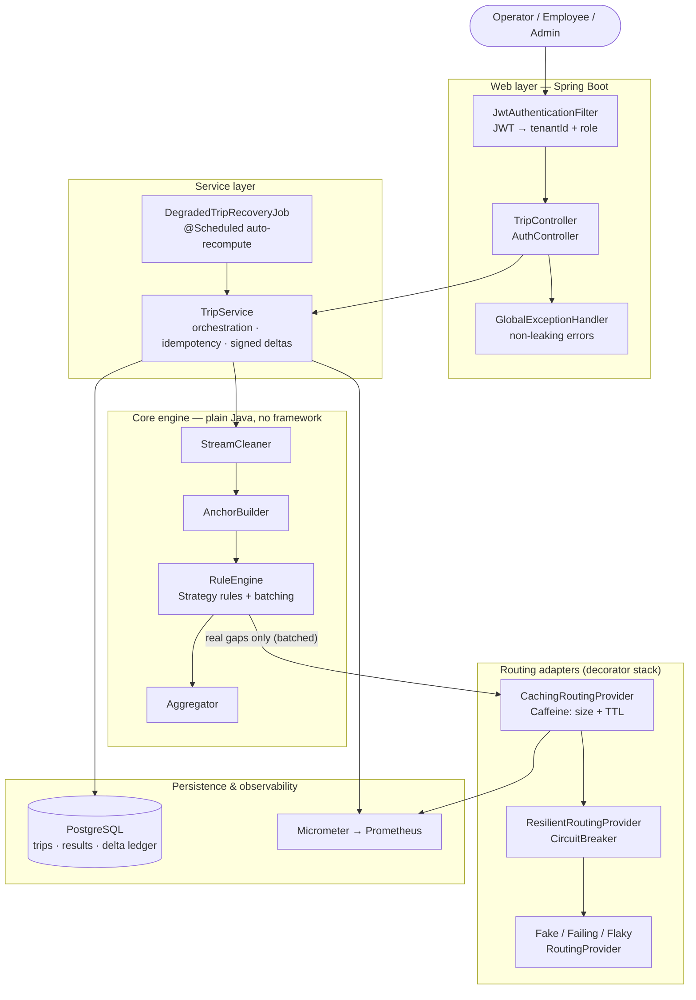
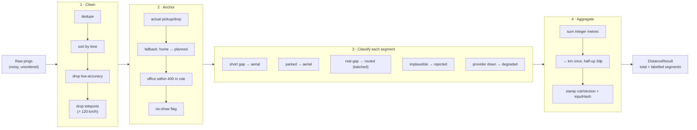
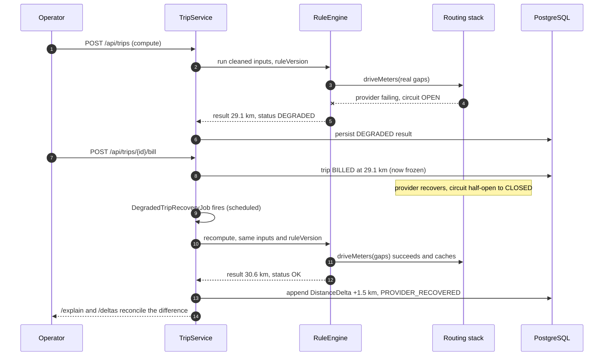

# GPS Gap Backfill & Billable Distance Reconstruction

[](https://github.com/Siddharth-singh2111/moveinsync-assignment/actions/workflows/ci.yml)
&nbsp;·&nbsp; Java 21 &nbsp;·&nbsp; Spring Boot 3.3 &nbsp;·&nbsp; PostgreSQL &nbsp;·&nbsp; Caffeine &nbsp;·&nbsp; JWT &nbsp;·&nbsp; Micrometer

> **MoveInSync Backend Case Study 2026 · Case Study 1 (Advanced Track).**
> Cab vendors are paid **per kilometre**, so distance is money. The raw GPS signal is noisy —
> duplicates, out-of-order fixes, low-accuracy fixes, "teleport" jumps, and long gaps (tunnels,
> basements, dead phones). A naive ping-to-ping sum **under-pays** the vendor; calling a routing API
> for every gap **over-pays** on noise and **costs a fortune**. This service rebuilds a **trusted,
> deterministic, explainable** billable distance for every trip — cheap maths where it can, trusted
> anchor points where it must, and a cached, circuit-broken routing provider only for *real* gaps —
> and labels every segment with the rule that produced it, so a vendor dispute can be answered line
> by line.

For the full design rationale, the data model, the trade-off table and the as-built notes, see
**[DESIGN.md](DESIGN.md)**.

---

## Table of contents

- [What it guarantees](#what-it-guarantees)
- [Architecture at a glance](#architecture-at-a-glance)
- [The core pipeline](#the-core-pipeline)
- [The hardest flow (why this design exists)](#the-hardest-flow-why-this-design-exists)
- [Quick start](#quick-start)
- [Build, test and benchmark](#build-test-and-benchmark)
- [API reference](#api-reference)
- [Try it end to end](#try-it-end-to-end)
- [The distance rules](#the-distance-rules)
- [Configuration reference](#configuration-reference)
- [Benchmark results](#benchmark-results)
- [How this maps to the evaluation criteria](#how-this-maps-to-the-evaluation-criteria)
- [Package layout](#package-layout)
- [Tech stack](#tech-stack)

---

## What it guarantees

1. **Deterministic** — same inputs + same `ruleVersion` ⇒ *byte-identical* kilometres. Distances are
   summed in **integer metres** and converted to km exactly once, rounded half-up to 3 decimals, so
   there is no floating-point drift. Two runs that disagree by 0.1 km would be a billing bug; a
   golden-file test asserts they never do.
2. **Explainable** — every output segment carries the rule that produced it (`SHORT_GAP_AERIAL`,
   `PARKED`, `ROUTED`, `REJECTED_SPEED`, `DEGRADED_AERIAL`). The `/explain` endpoint returns the full
   segment-by-segment breakdown — the view you put in front of a vendor during a dispute.
3. **Resilient** — if the routing provider fails, a **circuit breaker** opens, the trip is billed on
   a bounded aerial estimate and marked `DEGRADED`, and a background job **auto-recomputes** it once
   the provider recovers. The system never blocks billing on a flaky dependency.
4. **Idempotent & honest** — a billed trip's distance is **never rewritten**. Late pings, a provider
   recovery, or a rule-version bump append a **signed delta** (`+1.8 km`, with a reason) to an
   append-only ledger. Billing reconciles from deltas; the closed invoice stays frozen.
5. **Tenant-isolated** — the tenant is taken from the **JWT**, never from the request body, so one
   client can never read another's trips. No coordinates, phone numbers or emails appear in logs or
   error bodies.

---

## Architecture at a glance

A clean **controller → service → framework-free core → adapters** layering. The entire distance
algorithm lives in `core` and has **no Spring, no database, no HTTP**, so every rule is unit-testable
in complete isolation. The web, persistence and routing concerns wrap around it.



**Why it's shaped this way**

- **`RuleEngine` is a chain of `SegmentClassifier` strategies** evaluated in a fixed, versioned
  order. Determinism is a property of *(strategy order + rule version)*, not of call timing. The
  engine classifies all the cheap cases first, collects the *real* gaps, sends them to the provider
  in **one batched round-trip**, then assembles the result.
- **`RoutingProvider` is an interface.** The cache, the circuit breaker and the base providers
  (deterministic fake / fault-injecting) are layered as decorators (`cache → breaker → base`), so the
  breaker never counts a cache hit and the cache treats a breaker fast-fail as a miss. A real HTTP
  provider drops in without touching the engine.
- **Idempotency lives in the service**, keyed by `(tripId, inputHash, ruleVersion)`. Re-running with
  identical inputs returns the stored result instead of recomputing.

---

## The core pipeline

Every trip goes through the same four deterministic stages. Nothing here touches the network or the
database — it is pure, testable Java.



Per-trip cost is `O(n log n)` for the sort plus `O(n)` for the rest (`n` = pings). Provider calls are
bounded by the number of **distinct real gaps**, then collapsed further by the cache.

---

## The hardest flow (why this design exists)

This single flow exercises caching, the circuit breaker, idempotency and the delta ledger at once:
the provider is **down** during the first compute → the trip is billed as `DEGRADED` → the provider
**recovers** → a background job recomputes → a **signed delta** is appended, and the billed invoice is
left untouched.



---

## Quick start

**Only Docker is required** — the app is compiled *inside* the image, so you do not need a local JDK
or Maven to run it.

```bash
docker compose up --build
```

This starts PostgreSQL 16 and the service. The API comes up on **http://localhost:8080**.

Then open either of the two built-in views, or drive the API directly:

| View | URL | What it does |
|---|---|---|
| **Visual demo** | http://localhost:8080/map.html | One click computes a sample trip and draws it on a map, each segment colour-coded by its rule. |
| **Interactive API docs** | http://localhost:8080/swagger-ui.html | Click **Authorize**, paste a token from `/api/auth/login`, and run every endpoint from the browser. |
| **Health** | http://localhost:8080/actuator/health | Public liveness check. |
| **Metrics** | http://localhost:8080/actuator/prometheus | Prometheus scrape (authenticated). |

To stop and remove everything:

```bash
docker compose down -v
```

---

## Build, test and benchmark

A JDK 21 toolchain is needed for these (the Maven wrapper `./mvnw` is checked in, so Maven itself is
not). No Docker is required for the test suite — it uses in-memory **H2**.

```bash
./mvnw test                 # full unit + web + persistence suite (H2, no Docker)
./mvnw verify               # test + the Testcontainers PostgreSQL integration test
./mvnw -q package           # build the runnable jar (target/*.jar)

./run-benchmark.sh          # headless load test: 10,000 trips × 1,500 pings
./run-benchmark.sh 2000 1000  # custom size: <trips> <pings-per-trip>
```

Run the built jar directly (expects a reachable PostgreSQL — see
[Configuration](#configuration-reference) for the env vars):

```bash
java -jar target/*.jar
```

**Continuous integration.** GitHub Actions runs the whole suite on every push (`./mvnw -B verify` on
JDK 21). That includes an integration test that runs against a **real PostgreSQL** spun up by
Testcontainers; it skips automatically on machines without a reachable Docker daemon and runs on CI.

---

## API reference

All `/api/trips` endpoints require a **bearer token**. Obtain one from `/api/auth/login`. Three demo
users are defined in [`application.yml`](src/main/resources/application.yml), all on tenant `tenantA`:

| Username | Password | Role | Can |
|---|---|---|---|
| `operator` | `operator-pass` | `OPERATOR` | read + write (compute, ingest, bill, recompute) |
| `admin` | `admin-pass` | `ADMIN` | read + write |
| `viewer` | `viewer-pass` | `EMPLOYEE` | read only (`GET` endpoints) |

| Method | Path | Role | Purpose |
|---|---|---|---|
| `POST` | `/api/auth/login` | — | Exchange credentials for a JWT |
| `POST` | `/api/trips` | operator/admin | Compute a trip (idempotent on identical inputs) |
| `GET`  | `/api/trips/{id}/distance` | any | Total km, status, provider-call count |
| `GET`  | `/api/trips/{id}/explain` | any | Per-segment rule breakdown (the dispute view) |
| `POST` | `/api/trips/{id}/pings` | operator/admin | Add late/out-of-order pings → recompute |
| `POST` | `/api/trips/{id}/recompute` | operator/admin | Recompute from stored inputs |
| `POST` | `/api/trips/{id}/bill` | operator/admin | Close the invoice (freezes the distance) |
| `GET`  | `/api/trips/{id}/deltas` | any | Signed-delta ledger |

Access control: a missing or invalid token returns **401**; a valid token with the wrong role returns
**403**; a trip belonging to another tenant returns **404** (it simply does not exist for you).

### Example payloads

**Log in** — returns the token used as `Authorization: Bearer <token>` on every other call.

```bash
curl -s -X POST http://localhost:8080/api/auth/login \
  -H 'Content-Type: application/json' \
  -d '{"username":"operator","password":"operator-pass"}'
```
```json
{ "token": "eyJhbGciOiJIUzI1NiJ9...", "tenantId": "tenantA", "role": "OPERATOR" }
```

**Compute a trip.** Only `tripId` is required; `pings` carry the raw fixes, and `milestones` /
`riders` / the office fields feed the anchor stage.

```bash
curl -s -X POST http://localhost:8080/api/trips \
  -H "Authorization: Bearer $TOKEN" -H 'Content-Type: application/json' -d '{
    "tripId": "demo-1",
    "pings": [
      {"lat":12.9000,"lon":77.6000,"timestamp":"2026-01-01T00:00:00Z","accuracyMeters":10},
      {"lat":12.9450,"lon":77.6000,"timestamp":"2026-01-01T00:10:00Z","accuracyMeters":10}
    ],
    "milestones": [],
    "riders": []
  }'
```
```json
{
  "tripId": "demo-1",
  "totalKm": 6.505,
  "totalMeters": 6505,
  "status": "OK",
  "providerCalls": 1,
  "ruleVersion": 1,
  "inputHash": "9f2c…",
  "computedAt": "2026-01-01T00:10:05Z",
  "appendedDelta": null
}
```

**Explain** — the segment-by-segment view, each tagged with the rule that produced it:

```bash
curl -s http://localhost:8080/api/trips/demo-1/explain -H "Authorization: Bearer $TOKEN"
```
```json
{
  "tripId": "demo-1",
  "totalKm": 6.505,
  "status": "OK",
  "segments": [
    {"fromLat":12.9000,"fromLon":77.6000,"toLat":12.9450,"toLon":77.6000,
     "meters":6505,"rule":"ROUTED","providerCall":true}
  ]
}
```

**Late pings after billing** — the response's `appendedDelta` is the signed correction; the billed
total is never rewritten:

```json
{ "tripId":"demo-1", "totalKm":6.505, "status":"BILLED",
  "appendedDelta": { "deltaKm":6.505, "deltaMeters":6505, "reason":"late-pings",
                     "fromRef":"…", "toRef":"…", "createdAt":"2026-01-01T00:20:03Z" } }
```

---

## Try it end to end

[`demo.sh`](demo.sh) runs the whole story against a running `docker compose` —
login → compute → explain → bill → late pings (which append a signed delta) → ledger:

```bash
./demo.sh                       # against http://localhost:8080
BASE=http://host:8080 ./demo.sh  # against another host
```

---

## The distance rules

For each consecutive pair of points on the cleaned, anchored timeline, the engine picks exactly one
rule — cheap cases first, the paid provider only for genuine gaps:

| Condition | Rule | Distance used |
|---|---|---|
| Gap below `short-gap-seconds` at plausible speed | `SHORT_GAP_AERIAL` | haversine (straight line) |
| Long gap but speed below `parked-speed-kmh` | `PARKED` | haversine (cab barely moved) |
| A genuine gap | `ROUTED` | provider driving distance (batched + cached) |
| Routed segment > `routed-max-km`, or implausibly fast | `REJECTED_SPEED` | bounded fallback (haversine × 1.4) |
| Provider circuit is open | `DEGRADED_AERIAL` | haversine × `degraded-multiplier`; trip → `DEGRADED` |

---

## Configuration reference

Everything is overridable via environment variables or `application.yml`. The active rule set is
stamped onto every result as `ruleVersion`, so a threshold change is always traceable.

**Connection & secrets (env vars):**

| Variable | Default | Purpose |
|---|---|---|
| `SPRING_DATASOURCE_URL` | `jdbc:postgresql://localhost:5432/distance` | PostgreSQL JDBC URL |
| `SPRING_DATASOURCE_USERNAME` | `distance` | DB user |
| `SPRING_DATASOURCE_PASSWORD` | `distance` | DB password |
| `DISTANCE_AUTH_SECRET` | dev secret (change in prod) | JWT signing key (**≥ 32 bytes**) |

**Domain thresholds (`distance.*` in `application.yml`):**

| Key | Default | Meaning |
|---|---|---|
| `rules.version` | `1` | Rule-set version stamped on every result |
| `rules.max-speed-kmh` | `120` | Teleport filter + routed-speed sanity limit |
| `rules.min-accuracy-m` | `50` | Drop fixes less accurate than this |
| `rules.short-gap-seconds` | `70` | Below this, a plausible-speed gap is aerial |
| `rules.parked-speed-kmh` | `5` | Below this over a long gap, the cab was parked |
| `rules.office-radius-m` | `400` | Actual trip-end accepted only within this of the office |
| `rules.routed-max-km` | `100` | Reject a single routed segment above this |
| `rules.degraded-multiplier` | `1.4` | Aerial multiplier when the provider is down |
| `rules.include-no-show-anchors` | `true` | Whether no-show locations become anchors |
| `cache.snap-decimals` | `3` | Coordinate decimals for the routing-cache cell key |
| `cache.max-size` | `100000` | LRU bound on cached routes (memory cap) |
| `cache.ttl-hours` | `168` | Cache entry lifetime (7 days — bounds staleness) |
| `provider.road-factor` | `1.3` | Fake provider: drive distance = aerial × this |
| `provider.circuit-failure-threshold` | `5` | Consecutive failures before the circuit opens |
| `provider.circuit-open-seconds` | `10` | Cooldown before a half-open probe |
| `recovery.interval-ms` | `30000` | How often degraded trips are auto-recomputed |
| `auth.token-ttl-minutes` | `120` | JWT lifetime |

---

## Benchmark results

Measured locally (Apple Silicon laptop, JDK), **10,000 trips × 1,500 pings**:

| Metric | Value |
|---|---|
| Total time | 2.57 s (~3,900 trips/s) |
| Compute latency p50 / p99 | 0.23 ms / 0.50 ms |
| Routing calls before → after caching | **105,000 → 16** |
| Batched round-trips to the provider (whole run) | **6** |
| Heap used | ~67 MB |

The before-vs-after routing number is the headline: the cache plus batching turn 105,000 would-be
provider calls into 16 actual lookups across just 6 network round-trips. Reproduce it with
`./run-benchmark.sh`.

---

## How this maps to the evaluation criteria

1. **Authentication & tenant isolation** — stateless JWT, roles (employee/operator/admin), tenant
   taken from the token; cross-tenant reads return 404, missing token 401, wrong role 403.
2. **Cost (time & space)** — `O(n log n)` per trip, provider calls bounded by distinct gaps, backed
   by the benchmark above.
3. **Failure handling** — circuit breaker + degraded fallback + scheduled auto-recompute; a
   failure-injection test (`FlakyRoutingProvider`) fails midway through a batch and the trips recover
   and reconcile via deltas.
4. **OOP** — clean controller/service/repository layering; a framework-free `core` engine; the
   Strategy pattern for segment rules; polymorphic, decorator-stacked routing providers.
5. **Trade-offs** — documented in [DESIGN.md §12](DESIGN.md) (cost vs accuracy, degrade vs fail,
   append vs mutate, deterministic vs real-time).
6. **Monitoring** — Micrometer counters/gauges/timer: provider calls, cache hits, degraded trips,
   rejections, deltas, and compute p50/p99.
7. **Caching** — snapped-cell routing cache (Caffeine, size + TTL) with before/after call counts
   (105k → 16).
8. **Error handling** — non-leaking `@RestControllerAdvice`; no coordinates, phone or email in logs
   or error bodies.

---

## Package layout

```
com.moveinsync.distance
├── core            framework-free engine (no Spring, no DB, no HTTP)
│   ├── model         Ping, Anchor, Segment, DistanceResult, TimelinePoint, …
│   ├── clean         StreamCleaner — dedupe, order, accuracy, teleport
│   ├── anchor        AnchorBuilder — patch gaps, fallback chain, 400 m office rule
│   ├── rule          RuleEngine + ordered SegmentClassifier strategies (two-phase batching)
│   ├── distance      haversine + metre/km rounding
│   ├── routing       RoutingProvider port + hand-rolled CircuitBreaker
│   └── engine        DistanceEngine pipeline, input hashing, signed deltas
├── routing         adapters: caching (Caffeine), resilient (breaker), fake/failing/flaky
├── service         orchestration, idempotent recompute, delta reconciliation, recovery job
├── persistence     JPA entities + tenant-scoped repositories
├── api             REST controllers, DTOs, non-leaking error handling
├── security        JWT auth, roles, filter, Spring Security config
├── metrics         Micrometer meters
├── config          engine bean wiring from configuration properties
└── benchmark       headless 10k-trip load test
```

---

## Tech stack

Java 21 · Spring Boot 3.3 · PostgreSQL 16 · Caffeine (in-process routing cache) · a hand-rolled,
unit-tested circuit breaker · JWT auth (jjwt) · Spring Security · Micrometer + Prometheus ·
springdoc OpenAPI (Swagger UI) · Leaflet (map view) · JUnit 5 with H2 for the web/persistence tests
and Testcontainers for the real-PostgreSQL integration test · Docker Compose.
